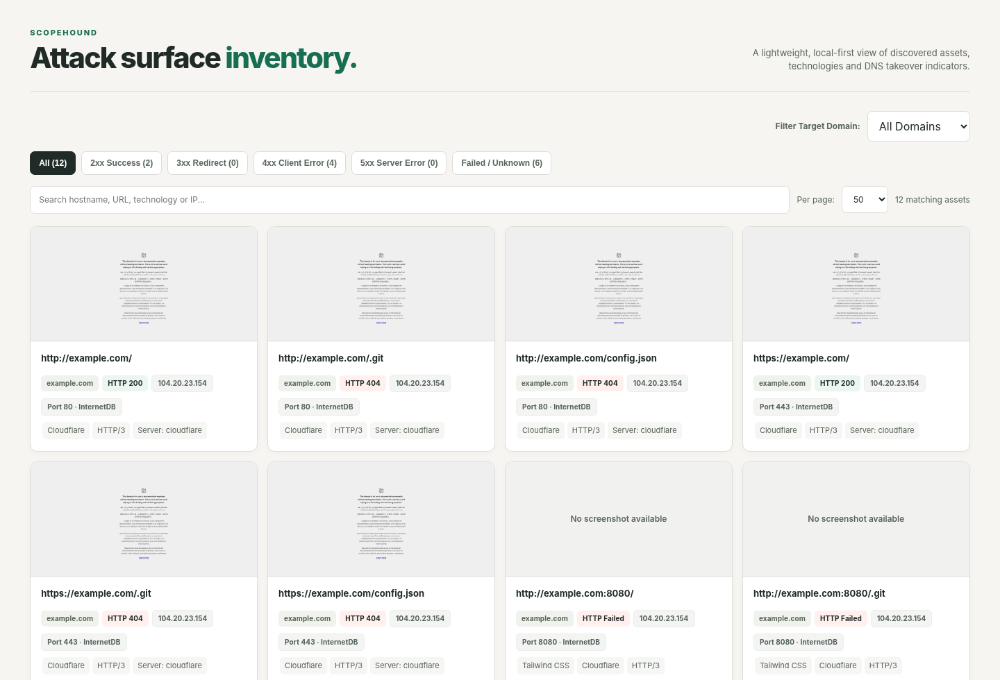
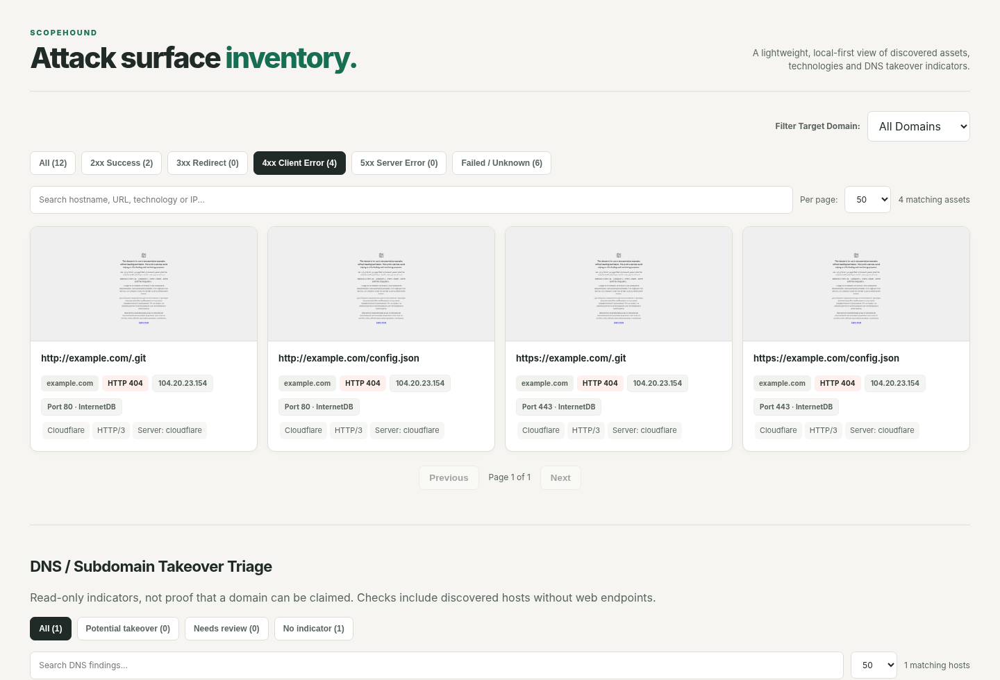
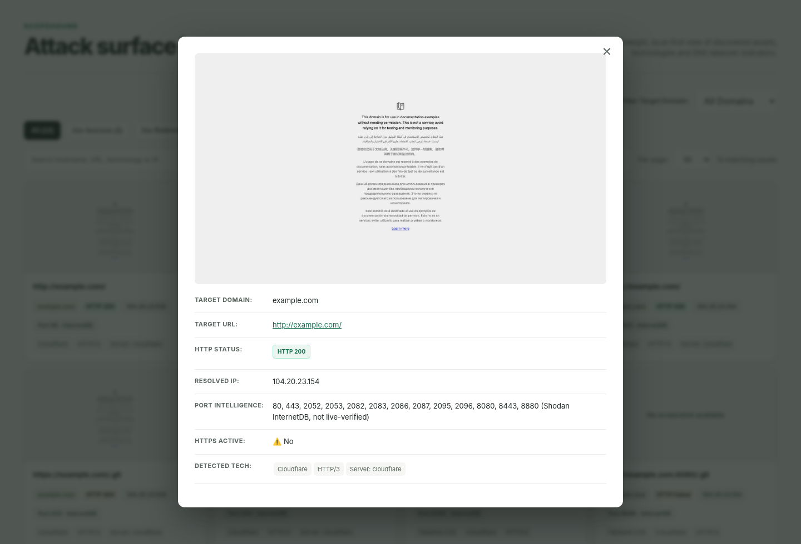
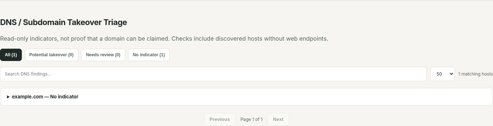

# ScopeHound

Lightweight Python-based attack surface discovery, technology fingerprinting, and DNS takeover triage.

ScopeHound is an open-source Python scanner for building an inventory of internet-facing assets. Provide a list of parent domains for enumeration, or skip enumeration and scan a developer-supplied list of subdomains. The tool enriches findings with Shodan InternetDB, Wappalyzer, Playwright screenshots, and DNS takeover indicators, then produces an HTML report for local review.

## Project Philosophy

ScopeHound is designed to be **easy to install, easy to run, and easy to understand**. It stays lightweight, open-source, CLI-first, and local-first, with straightforward commands and self-contained HTML reports. Development prioritizes **accessibility, accuracy, stability, security, and compatibility** over unnecessary features or infrastructure dependencies.

ScopeHound does not include user accounts, built-in authentication, or a hosted management service. You can run it locally, in Docker, or within your own automation and infrastructure.

## Features

- Subdomain discovery with **Subfinder**
- Support for **developer-supplied subdomain lists**
- DNS resolution and grouping by parent domain
- Web asset probing on common web ports
- **Shodan InternetDB** enrichment for IP and port intelligence
- **Wappalyzer** technology fingerprinting
- **Playwright** screenshots for reachable web assets
- **DNS / subdomain takeover triage** with provider fingerprints
- Searchable HTML report with filtering, pagination, and modal asset details
- Optional **Docker** support for local or unattended runs

## Screenshots

### Dashboard overview


### HTTP status filters


### Asset details


### DNS takeover triage


## Requirements

- Python 3.10+
- Google Chrome / Chromium (for Playwright screenshots)
- Go-installed **Subfinder** in `PATH` if you want automatic enumeration

Install Python dependencies:

```bash
pip install -r requirements.txt
```

Install Playwright browser support:

```bash
python -m playwright install chromium
```

## Quick start (Python)

### 1. Create `domains.txt`

```text
example.com
```

### 2. Run ScopeHound with Subfinder

```bash
python asm.py -f domains.txt
```

### 3. Or skip enumeration and use your own subdomains

```bash
python asm.py -f domains.txt --input-subdomains subdomains.txt
```

### 4. Legacy wordlist discovery mode

```bash
python asm.py -f domains.txt --discovery wordlist -s subdomains.txt
```

## Reports

ScopeHound automatically creates a `reports/` folder and saves generated HTML scan reports there.

## Docker (optional)

Build:

```bash
docker build -t scopehound .
```

Run:

```bash
docker run --rm \
  -v "$PWD/domains.txt:/app/domains.txt:ro" \
  -v "$PWD/reports:/app/reports" \
  scopehound
```

Scheduled mode:

```bash
docker run -d \
  --name scopehound \
  --restart unless-stopped \
  -v "$PWD/domains.txt:/app/domains.txt:ro" \
  -v "$PWD/reports:/app/reports" \
  scopehound --interval-hours 24
```

## Deployment and Access Control

ScopeHound does not provide built-in authentication or hosted services. **Users are responsible for securing their own deployments**, including authentication, access controls, network exposure, and generated scan reports. Avoid publishing reports containing sensitive asset information to publicly accessible locations.

## Notes and limitations

- ScopeHound is a **local, read-only inventory and triage tool**. It is not an exploit framework.
- DNS takeover findings are **indicators** only. They are not proof that a service can be claimed.
- Port information comes from **Shodan InternetDB** when available. Fallback web targets are probe candidates, not confirmed open ports.
- Screenshots are captured only for web targets that can be reached by Playwright.
- Use ScopeHound only on domains and assets you own or are explicitly authorized to assess.

## Security

If you believe you have found a vulnerability in ScopeHound itself, please use GitHub private vulnerability reporting or follow the guidance in `SECURITY.md`.

## Maintainer

- **Mateo Carbon** — johnmatthew.carbon@gmail.com

## License

Released under the **MIT License**. See `LICENSE` for details.
