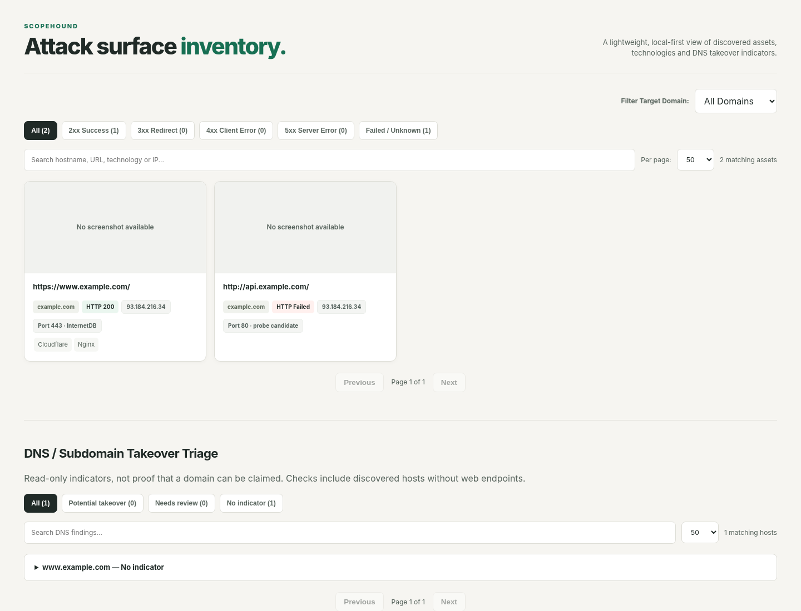
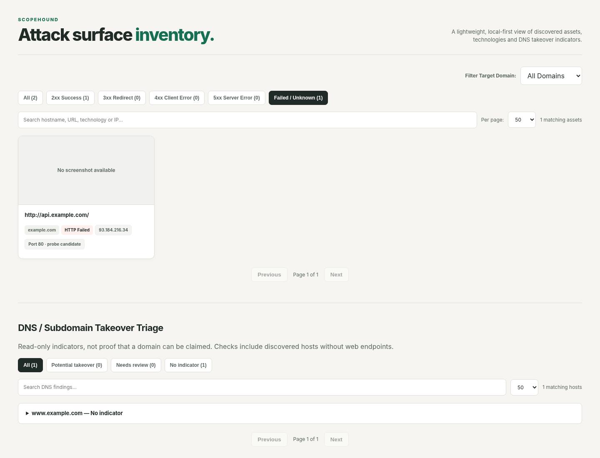
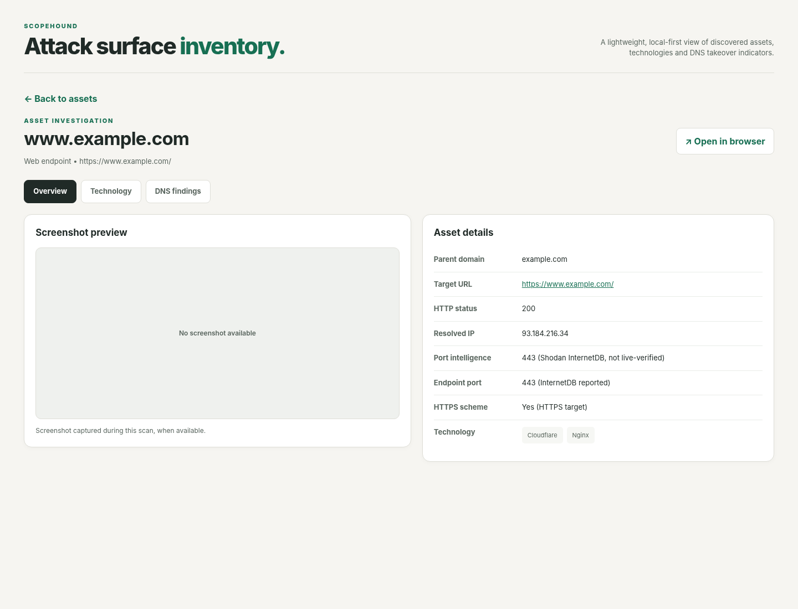
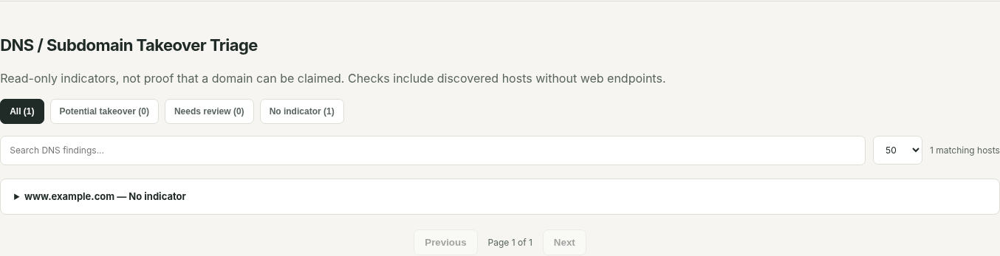

# ScopeHound

Lightweight Python-based attack surface discovery, technology fingerprinting, and DNS takeover triage.

ScopeHound is an open-source Python scanner for building an inventory of internet-facing assets. Provide a list of parent domains for enumeration, or skip enumeration and scan a developer-supplied list of subdomains. The tool enriches findings with Shodan InternetDB, Wappalyzer, Playwright screenshots, and DNS takeover indicators, then produces an HTML report for local review.

## Project Philosophy

ScopeHound is designed to be **easy to install, easy to run, and easy to understand**. It stays lightweight, open-source, CLI-first, and local-first, with straightforward commands and self-contained HTML reports. Development prioritizes **accessibility, accuracy, stability, security, and compatibility** over unnecessary features or infrastructure dependencies.

ScopeHound does not include user accounts, built-in authentication, or a hosted management service. You can run it locally, in Docker, or within your own automation and infrastructure.

## Features

- Subdomain discovery with **Subfinder**
- Support for **developer-supplied subdomain lists**
- DNS resolution and grouping by parent domain
- Focused web inventory: **HTTP 80 / HTTPS 443 by default**, optional alternate ports
- **Shodan InternetDB** enrichment for IP and port intelligence
- **Wappalyzer** technology fingerprinting
- **Playwright** screenshots for reachable web assets
- **DNS / subdomain takeover triage** with provider fingerprints
- Searchable HTML report with filtering, pagination, and dedicated asset details
- Optional **Docker** support for local or unattended runs
- Optional compact **AI-ready JSON** export (manual upload or bring-your-own agent)
- Optional separate **sensitive-path status checks**

## Screenshots

### Dashboard overview


### HTTP status filters


### Asset details


### DNS takeover triage


## Requirements

- Python 3.10+
- Google Chrome / Chromium (for Playwright screenshots)
- Go-installed **Subfinder** in `PATH` if you want automatic enumeration

Install Python dependencies:

```bash
pip install -r requirements.txt
```

Install Playwright browser support:

```bash
python -m playwright install chromium
```

## Quick start (Python)

### 1. Create `domains.txt`

```text
example.com
```

### 2. Run ScopeHound with Subfinder

```bash
python asm.py -f domains.txt
```

### 3. Or skip enumeration and use your own subdomains

```bash
python asm.py -f domains.txt --input-subdomains subdomains.txt
```

### 4. Legacy wordlist discovery mode

```bash
python asm.py -f domains.txt --discovery wordlist -s subdomains.txt
```

### Web port selection (v0.2.0)

ScopeHound uses **80 and 443 by default** for browser-based fingerprinting and screenshots. InternetDB may report other ports, but they are **not automatically browsed**. InternetDB port intelligence is still included in each asset's details when available; a reported port does not necessarily mean it is reachable now.

To opt into common alternate HTTP(S) ports on hosts you are authorized to scan:

```bash
python asm.py -f domains.txt --extra-web-ports 8080,8443
```

Supported extra ports are `81`, `8000`, `8080` (HTTP), and `8443` (HTTPS). Specify them as a comma-separated list; other values are rejected. Opting in does not force a probe of an alternate port absent from the Shodan InternetDB candidate list. When InternetDB offers no usable port data, fallback candidates remain **80 and 443 only**. These are candidate endpoints, **not verified open ports**.

This reduces unnecessary browser navigation on alternate ports while keeping those checks available when needed. A target may run its website *only* on an alternate port, so enable the corresponding option when the assessment requires it.

### Optional sensitive-path checks

By default, ScopeHound visits **only `/`** for web fingerprinting and screenshots. This avoids running the browser and Wappalyzer against sensitive-path candidates.

To run separate status-only HTTP checks using `dangerous_paths.txt`:

```bash
python asm.py -f domains.txt --check-exposures
```

To use another root-relative path file (one path per line):

```bash
python asm.py -f domains.txt --check-exposures --paths my_paths.txt
```

This module does **not** run screenshots or Wappalyzer on these paths, follow HTTP redirects, or store response bodies. It writes results to `reports/exposure_checks_<timestamp>.json`, separate from the HTML dashboard. A `200` response means **needs review**, not confirmed sensitive-data exposure; catch-all application routing can return `200` for nonexistent paths. Keep path lists small and only scan authorized assets.

## Parallel scanning (one combined report)

ScopeHound accepts any number of parent domains in `domains.txt`; it queues all of them and runs a **bounded** number concurrently. The default `--parallel-domains auto` derives a conservative concurrency limit from available CPUs (2–8 workers, never more than the input domain count). Override the limit when scanning authorized infrastructure:

```bash
python asm.py -f domains.txt --parallel-domains auto --json
python asm.py -f domains.txt --parallel-domains 4 --json
```

This parallelizes parent-domain discovery and DNS resolution, with shared limits for DNS lookups and Shodan requests. Results are merged and deduplicated before a single shared Playwright browser pool runs; each scan produces one HTML report and optionally one compact AI JSON report. A failed domain is recorded in a separate `domain_failures_*.json` file so partial success is not mistaken for a complete scan. Higher concurrency can increase load on your machine, DNS resolver, and assessed infrastructure; start with `auto` and tune responsibly. Runtime improvements depend on network conditions and the number of resolved hosts per domain.

## Reports

HTML reports include browser-based web inventory and DNS takeover triage. Path-check JSON is saved separately, and **the compact AI JSON export is opt-in**. Reports may describe sensitive infrastructure and should be secured accordingly.


ScopeHound automatically creates `reports/` and saves standalone HTML there. The optional exposure checker writes a separate status-only JSON. With `--json`, ScopeHound also writes a compact, screenshot-free `scopehound_ai_*.json` containing asset inventory, DNS takeover triage, and optional exposure check outcomes. JSON output is not a claim that vulnerabilities are confirmed.

### Optional AI-ready JSON (v0.2.0)

```bash
python asm.py -f domains.txt --json
python asm.py -f domains.txt --json --check-exposures
```

**Manual ingestion:** Upload the `scopehound_ai_*.json` report to an approved AI assistant and ask it to prioritize observed evidence, state uncertainty, and propose verification/remediation steps.

**Bring your own agent:** Feed the JSON file into your own LLM API or agent workflow. ScopeHound does not call AI APIs, require API keys, send notifications, or map asset owners. Treat both JSON content and external responses as untrusted data; do not upload sensitive reports to unapproved services.

The JSON schema is versioned (`schema_version: 1.0`). Screenshots and their Base64 data are intentionally excluded to reduce size and token cost.

## Docker (optional)

The Docker image runs one `asm.py` entrypoint and includes Subfinder, Chromium, the DNS triage module, and `dangerous_paths.txt`. No database, AI API key, or separately scheduled microservices are required.

Build:

```bash
docker build -t scopehound:0.2.0 .
```

Run:

```bash
docker run --rm \
  -v "$PWD/domains.txt:/app/domains.txt:ro" \
  -v "$PWD/reports:/app/reports" \
  scopehound:0.2.0 --json
```

To include alternate ports in Docker, append `--extra-web-ports 8080,8443` to the command after the image name. For a supplied host list, mount `subdomains.txt` at `/app/subdomains.txt:ro` and add `--input-subdomains subdomains.txt`.

Scheduled mode:

```bash
docker run -d \
  --name scopehound \
  --restart unless-stopped \
  -v "$PWD/domains.txt:/app/domains.txt:ro" \
  -v "$PWD/reports:/app/reports" \
  scopehound:0.2.0 --json --check-exposures --interval-hours 24
```

**Docker notes:** The image includes `dangerous_paths.txt`, Chromium, and Subfinder. Mount `reports/` to persist scan results. To customize path checks, mount your own list as a read-only file: `-v "$PWD/my_paths.txt:/app/my_paths.txt:ro"`, then pass `--paths my_paths.txt`. For custom subdomains, mount the list and add `--input-subdomains`. Use only authorized domains and keep reports private. Build requires network access to install dependencies.

## Tests and release verification

```bash
python -m unittest discover -s tests -v
python -m compileall -q asm.py takeover.py tests
```

Before tagging `v0.2.0`, build and smoke-test the Docker image against a domain you control. Validate output files, browser screenshots, alternate port behavior, and Docker volume permissions. The unit suite uses mocks and does not establish that Docker or live scanning works in every environment.

## Deployment and Access Control

ScopeHound does not provide built-in authentication or hosted services. **Users are responsible for securing their own deployments**, including authentication, access controls, network exposure, and generated scan reports. Avoid publishing reports containing sensitive asset information to publicly accessible locations.

## Notes and limitations

- ScopeHound is a **local, read-only inventory and triage tool**. It is not an exploit framework.
- DNS takeover findings are **indicators** only. They are not proof that a service can be claimed.
- Port information comes from **Shodan InternetDB** when available. Fallback web targets are probe candidates, not confirmed open ports.
- Screenshots are captured only for web targets that can be reached by Playwright.
- Use ScopeHound only on domains and assets you own or are explicitly authorized to assess.

## Security

If you believe you have found a vulnerability in ScopeHound itself, please use GitHub private vulnerability reporting or follow the guidance in `SECURITY.md`.

## Maintainer

- **Mateo Carbon** — johnmatthew.carbon@gmail.com

## License

Released under the **MIT License**. See `LICENSE` for details.
