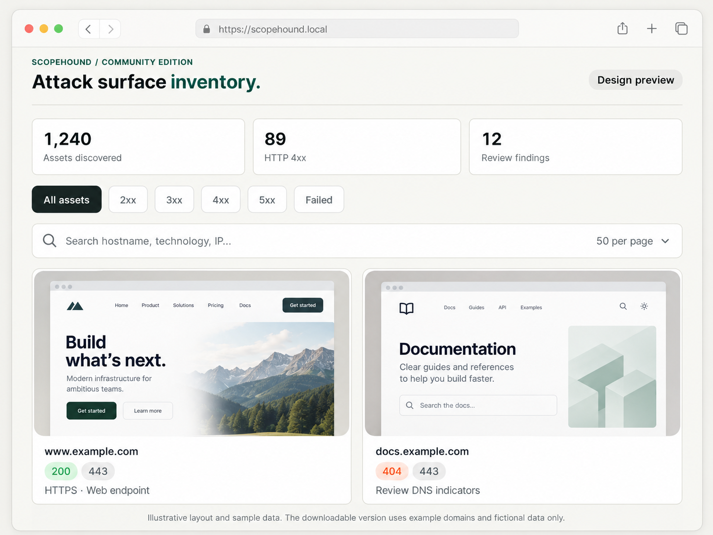
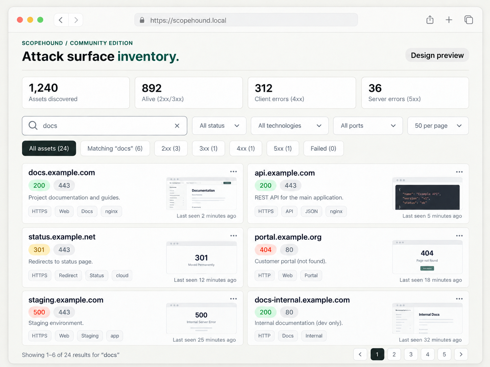
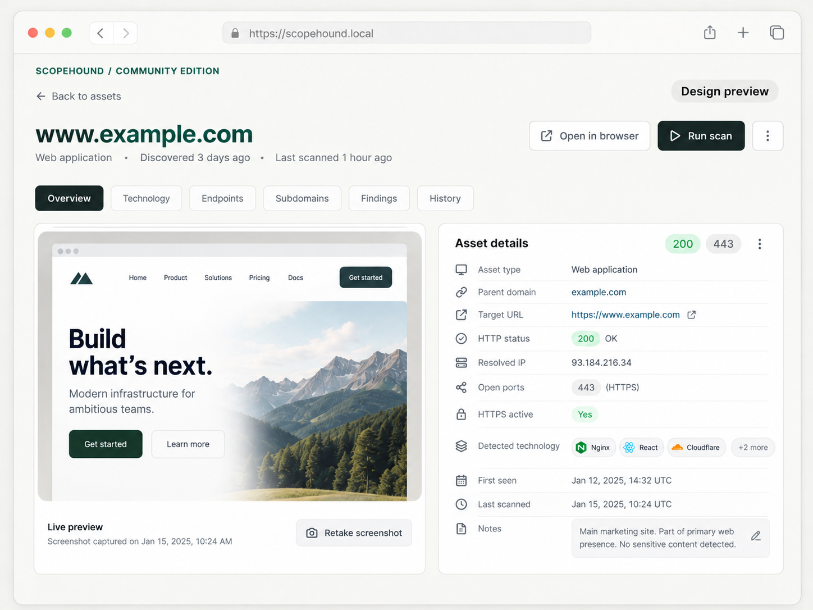

# ScopeHound

**Lightweight attack-surface discovery and DNS takeover triage.**

ScopeHound is an open-source Python scanner for building an inventory of internet-facing assets. Give it a list of parent domains, or supply your own subdomains. It combines DNS discovery, Shodan InternetDB enrichment, technology fingerprinting, screenshots, and a searchable HTML report.

The codebase is intentionally small and easy to modify. Python is the primary way to run it; Docker is optional.

## Features

- Subdomain discovery with [Subfinder](https://github.com/projectdiscovery/subfinder), or an existing list of hostnames
- DNS resolution and open-port context from [Shodan InternetDB](https://internetdb.shodan.io/)
- Web technology detection with Wappalyzer and screenshots with Playwright
- HTTP response filters, search, pagination, and expandable results in a standalone HTML report
- DNS CNAME/NS checks and provider error fingerprints for **potential** subdomain takeovers
- Performs port scanning to check for critical open ports
- Optional recurring scans with `--interval-hours`

> **Use only on assets you own or are authorized to assess.** The scanner requests `/`, `/.git`, and `/config.json` on selected web endpoints. Reports may contain sensitive infrastructure details and screenshots. Keep them private.

## Quick start (Python)

**Requirements:** Python 3.11+ and a working network connection. Install [Subfinder](https://github.com/projectdiscovery/subfinder) and make sure it is on `PATH` for automatic enumeration. If you provide your own hostname list, Subfinder is not required.

```bash
python3 -m venv .venv
source .venv/bin/activate
pip install -r requirements.txt
python -m playwright install chromium
```

On Windows, activate the environment using `.venv\Scripts\activate`.

Put one authorized parent domain per line in `domains.txt`, then run:

```bash
python asm.py -f domains.txt
```

To skip discovery and scan your own list of full hostnames (one per line):

```bash
python asm.py -f domains.txt --input-subdomains my-subdomains.txt
```

Every supplied hostname must belong to one of the parent domains in `domains.txt`.

If you don't have Subfinder, you can use a DNS prefix wordlist instead:

```bash
python asm.py -f domains.txt --discovery wordlist -s subdomains.txt
```

Reports are saved in `reports/` as self-contained HTML files. Open a report in your browser; no server is required.

## Docker (optional)

Build the image:

```bash
docker build -t scopehound .
```

Run a scan, keeping reports on your host:

```bash
mkdir -p reports
docker run --rm \
  -v "$PWD/domains.txt:/app/domains.txt:ro" \
  -v "$PWD/reports:/app/reports" \
  scopehound -f domains.txt
```

For an existing subdomain list, also mount the input file and pass `--input-subdomains`:

```bash
docker run --rm \
  -v "$PWD/domains.txt:/app/domains.txt:ro" \
  -v "$PWD/my-subdomains.txt:/app/my-subdomains.txt:ro" \
  -v "$PWD/reports:/app/reports" \
  scopehound -f domains.txt --input-subdomains my-subdomains.txt
```

## Repeating scans

For a simple unattended loop using Python:

```bash
python asm.py -f domains.txt --interval-hours 24
```

This repeats scans while the process is running. For persistent scheduling and monitoring, use your operating system's scheduler or an external job runner.

## Project layout

| File | Purpose |
| --- | --- |
| `asm.py` | CLI, discovery, enrichment, screenshots, HTML report, scan loop |
| `takeover.py` | Read-only DNS and provider-fingerprint takeover triage |
| `domains.txt` | Example authorized parent-domain input |
| `subdomains.txt` | Optional wordlist for DNS-prefix discovery |
| `tests/` | Input validation and detection tests |
| `Dockerfile` | Optional container build |

## Sample Screenshot
**Dashboard**

**Dashboard-Alternate**

**Subdomain-Takeover-Triage**

**FingerPrinting**



## Development

Run the tests:

```bash
python -m unittest discover -s tests -v
```

Small improvements and integrations are welcome. See [CONTRIBUTING.md](CONTRIBUTING.md).

## Detection limits

Takeover findings indicate **potential misconfiguration**, not confirmed exploitability. A CNAME pointing to an unavailable service, a provider error page, or an HTTP 404 does not by itself establish that a domain can be claimed. DNS information, service fingerprints, and InternetDB results may be incomplete or stale. Verify findings before taking action.

## Runtime Limitation
Depending on your lists, Runtime can vary. If youre planning to run this on a scheduled automation. It might be best to test around your operating hours

## Note from Maintainer
As much as I want to further enhance this with Authentication and add a DevOps pipeline for gitactions to instantly host and deploy. I currently do not have the time capacity but I am willing to talk with your ideas if you are interested!

## License

MIT. See [LICENSE](LICENSE).
